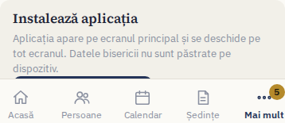
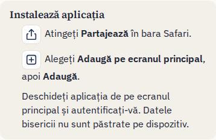
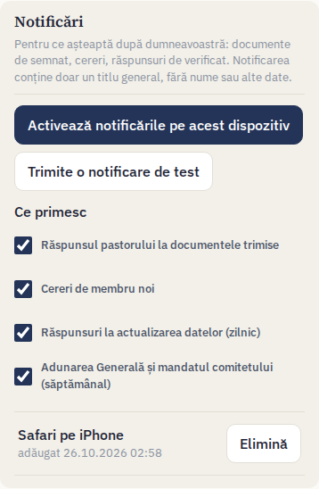
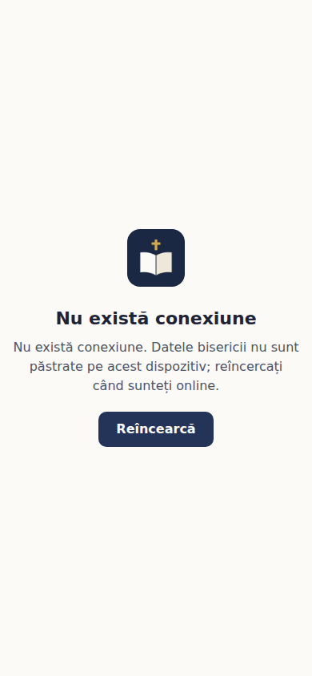
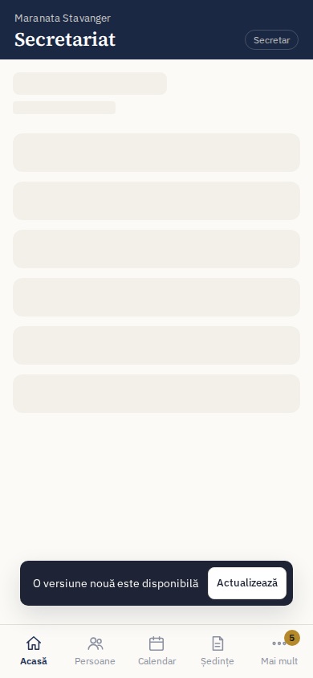

# Secretariat Biserică

Aplicație web pentru secretariatul bisericilor: registrul de persoane și familii, procese-verbale,
calendar cu agape, registrul de ieșire al documentelor (adeverințe, certificate, scrisori), darea de
seamă anuală, grupuri și mențiuni. Interfața este integral în limba română, gândită întâi pentru
telefon (meniu jos) și adaptată pentru desktop (bară laterală), cu mod luminos și întunecat.

Aplicația reimplementează într-o arhitectură de producție prototipul
[`prototip/secretariat-biserica.html`](prototip/secretariat-biserica.html), păstrând modelul de date,
calculul statisticilor, șabloanele de documente și darea de seamă. Echivalența este verificată automat
(vezi [Teste](#teste)).

## Funcționalități

| Modul | Ce face |
| --- | --- |
| **Acasă** | Persoane în evidență, membri (%), familii, botezați, aparținători, prieteni nebotezați, copii minori, copii ai membrilor, bărbați/femei, distribuția pe vârste, mișcarea anului, evenimente următoare, aniversări. Selector de an (situație retroactivă) și buton „Dare de seamă”. |
| **Persoane** | Registru complet (statut, familie și grad de rudenie, intrare/botez/binecuvântare/ieșire, comitet, funcții și slujiri pe grupuri, note). Filtre Membri / Toate / Foști, plus comitet, fără familie și fiecare funcție sau slujire; căutare fără diacritice (inclusiv după telefon), paginare, vedere pe familii. Fișa persoanei: familia, grupurile, mențiunile, documentele, istoricul modificărilor; „‹ Anterior” / „Următorul ›” urmează lista din care ați venit. |
| **Procese-verbale** | Numerotate pe an („PV nr. 16/2026”), cu tip, dată, prezenți și absenți, invitați, ordinea de zi, punctele discutate și aprobate, observații și formula de încheiere. PDF în formatul bisericii (`docs/samples/proces-verbal-model.md`), cu tabelul de semnături, sau document Word (.docx) cu același conținut, de editat și aranjat în Word („Deschide în Word”). „Așezare în pagină”: format A4/A5, margini, mărimea textului, spațierea rândurilor, alinierea și antetul (de oprit pentru hârtie cu antet tipărit), cu previzualizare; pentru un proces-verbal sau ca implicit al bisericii. Cei prezenți pot semna pe telefon sau tabletă; procesul-verbal semnat se închide și devine needitabil (doar administratorul îl redeschide). Procesele-verbale vechi se importă din fișiere Word (.docx, mai multe odată). Se trimite pe e-mail din aplicație (cu PDF-ul atașat, către pastor, secretar, cei prezenți sau alte adrese) sau se partajează de pe telefon. |
| **Calendar** | Vedere lunară (cu ședințele), liste viitoare/trecute, evenimente cu invitat, responsabil, descriere și agapă („cine aduce ce”). |
| **Documente** | Registru de ieșire cu numerotare automată pe an. Textul se generează din datele persoanei și ale bisericii, cu acordurile de gen, este editabil, apoi se salvează și se exportă PDF. |
| **Dare de seamă** | „Situația membrală la 31.12.AAAA” pentru orice an, calculată retroactiv; se salvează ca document în registru. |
| **Grupuri** | Nume, responsabil, descriere, persoane; listă tipăribilă (PDF). |
| **Mențiuni** | Note pe persoană sau familie, vizibile pe fișa persoanei. |
| **Cereri de membru** | Formular public `/cerere/<adresa-bisericii>` (pornit din Setări), cu acord pentru păstrarea datelor și, dacă biserica le-a încărcat în Setări, acordul cu statutul cultului și cu statutul intern (bifabile după deschiderea documentului). Cererile apar la „Cereri” (cu numărul celor în așteptare); „Acceptă” deschide fișa persoanei completată din cerere, „Respinge” păstrează motivul. În Setări: codul QR al formularului (descărcare PNG, afiș A5 în PDF), copiere și partajare a linkului, trimiterea linkului pe e-mail. |
| **Nota de informare** | Pagina publică `/confidentialitate/<adresa-bisericii>`: nota de informare 1.0 (`docs/privacy-notice-1.0.md`), completată cu datele bisericii, sau textul propriu al bisericii din Setări. Versiunile se numără de la publicarea pe `main`; pe `dev` nota e ciornă și se modifică pe loc. Fiecare acord păstrează versiunea notei la care se referă. |
| **Setări** | Datele organizației (antet și semnături), autentificare în doi pași (aplicație de autentificare sau cod pe e-mail, coduri de recuperare; poate fi obligatorie pentru toată biserica), nomenclatoare editabile, utilizatori și roluri (invitații și resetarea parolei, trimise pe e-mail), export/import JSON compatibil cu prototipul, jurnalul de modificări. |

Toate PDF-urile (documente, procese-verbale, liste de grup, fișe de eveniment, dare de seamă) sunt
generate pe server, cu antetul bisericii și semnăturile pastorului și secretarului.

## Tehnologii

- **Next.js 16** (App Router, Server Components, Server Actions) + **React 19** + **TypeScript**
- **PostgreSQL** + **Prisma 7** (driver `@prisma/adapter-pg`)
- **Auth.js v5** (`next-auth`) — autentificare cu e-mail și parolă, sesiuni JWT
- **Tailwind CSS 4** (tokenurile de design ale prototipului)
- **Zod 4** pentru validarea pe server, **pdfkit** pentru PDF, **Vitest** pentru teste

## Cerințe

- Node.js **22.12+**
- PostgreSQL **14+** cu extensia `pg_trgm` (inclusă în distribuțiile standard; migrarea o activează)

## Instalare (dezvoltare)

```bash
# 1. Dependențe (rulează și `prisma generate`)
npm install

# 2. PostgreSQL local — cu Docker (creează și baza pentru teste) …
docker compose up -d
#    … sau folosiți un server existent și creați bazele `secretariat` și `secretariat_test`.

# 3. Configurare
cp .env.example .env
#    generați AUTH_SECRET:  openssl rand -base64 32   (sau: npx auth secret)

# 4. Schema bazei de date
npx prisma migrate deploy

# 5. Date demo (opțional, recomandat pentru o primă vizită)
npm run db:seed

# 6. Pornire
npm run dev
```

Aplicația rulează la <http://localhost:3000>. Cu datele demo vă puteți autentifica cu:

| Cont | Rol | Parolă |
| --- | --- | --- |
| `admin@demo.ro` | Administrator | `demo1234` |
| `secretar@demo.ro` | Secretar | `demo1234` |
| `vizualizare@demo.ro` | Vizualizare | `demo1234` |
| `rugaciune@demo.ro` | Rugăciune | `demo1234` |

Fără date demo, deschideți `/inregistrare` și creați biserica și contul de administrator
(prima biserică se poate înregistra oricând cât timp baza de date e goală).

## Variabile de mediu

| Variabilă | Obligatorie | Descriere |
| --- | --- | --- |
| `DATABASE_URL` | da | Conexiunea PostgreSQL a aplicației și a migrărilor. |
| `AUTH_SECRET` | da | Cheia de semnare a sesiunilor (min. 32 de caractere aleatoare). |
| `AUTH_TRUST_HOST` | în producție | `true` când aplicația rulează în spatele unui reverse proxy sau cu `next start`. Numai atunci limitele pe adresă IP citesc adresa vizitatorului: `cf-connecting-ip`, `true-client-ip` sau ultima intrare din `X-Forwarded-For` (cea adăugată de proxy). |
| `AUTH_URL` | în spatele unui proxy | Adresa publică pentru Auth.js, aceeași valoare ca `APP_URL`. Fără ea, în spatele unui proxy (ex. Render) Auth.js vede adresa internă a serverului (`https://localhost:10000`). |
| `APP_URL` | recomandat | Adresa publică (ex. `https://secretariat.exemplu.ro`), folosită în linkurile de invitație și resetare a parolei. Necesară pentru trimiterea e-mailurilor. |
| `ALLOW_SIGNUP` | nu | `true` permite înregistrarea de biserici noi din `/inregistrare`. Implicit doar prima biserică. |
| `APP_TIME_ZONE` | nu | Fusul orar pentru „azi” (implicit `Europe/Bucharest`; ex. `Europe/Oslo`). |
| `RESEND_API_KEY` | nu | Cheia [Resend](https://resend.com) pentru trimiterea invitațiilor, a linkurilor de resetare și a proceselor-verbale pe e-mail. Fără ea, butonul „Trimite” al proceselor-verbale este dezactivat, iar administratorul copiază linkurile din **Setări → Utilizatori**. |
| `VAPID_PUBLIC_KEY`, `VAPID_PRIVATE_KEY` | nu | Perechea de chei pentru notificări (`npx web-push generate-vapid-keys`). Fără ele, secțiunea **Cont → Notificări** nu apare. |
| `VAPID_SUBJECT` | nu | `mailto:` urmat de adresa de e-mail a bisericii (contactul pentru serviciile de notificări). |
| `EMAIL_FROM` | nu | Expeditorul e-mailurilor (implicit `Secretariat Biserică <secretariat@sanctuaryvoice.com>`); domeniul trebuie verificat în Resend. |
| `TEST_DATABASE_URL` | pentru teste | Baza de date (separată!) pentru testele de integrare; fără ea sunt sărite. |

## Migrări Prisma

Schema este în [`prisma/schema.prisma`](prisma/schema.prisma), migrările în `prisma/migrations/`,
configurația în [`prisma.config.ts`](prisma.config.ts) (Prisma 7 citește `.env` prin `dotenv`).

| Comandă | Când |
| --- | --- |
| `npx prisma migrate deploy` (`npm run db:deploy`) | Aplică migrările existente — la instalare și la fiecare deploy în producție. |
| `npx prisma migrate dev --name <nume>` (`npm run db:migrate`) | În dezvoltare, după modificarea schemei: creează și aplică o migrare nouă. |
| `npx prisma generate` (`npm run db:generate`) | Regenerează clientul (`src/generated/prisma`, nu se comite). Rulează automat la `npm install`. |
| `npm run db:seed` | Încarcă biserica demo. Idempotent: recreează doar biserica cu id-ul `demo`. |
| `npm run db:reset` | **Șterge toată baza de date** și o recreează (doar în dezvoltare). |

Prima migrare activează `pg_trgm` și creează indexuri trigram pentru căutarea rapidă. Pe servere
administrate unde utilizatorul aplicației nu poate crea extensii, rulați o singură dată ca
administrator: `CREATE EXTENSION IF NOT EXISTS pg_trgm;`.

## Roluri

| Rol | Poate |
| --- | --- |
| **Administrator** | Tot: date, setările organizației, nomenclatoare, utilizatori și roluri, import. Biserica are mereu cel puțin un administrator activ. |
| **Secretar** | Adaugă, modifică și șterge în registre, emite documente, exportă datele, consultă jurnalul. |
| **Vizualizare** | Consultă și tipărește (PDF), inclusiv darea de seamă, fără a o înregistra. |

Utilizatorii noi sunt invitați din **Setări → Utilizatori**: se generează un link personal (valabil
7 zile), trimis pe e-mail când `RESEND_API_KEY` este setată; linkul rămâne vizibil pentru administrator,
care îl poate trimite și manual. Tot de acolo se trimit linkuri de resetare a parolei (valabile 48 de
ore), se schimbă rolul sau se dezactivează un cont (sesiunile deschise se închid imediat).

Utilizatorii își pot reseta singuri parola din **`/am-uitat-parola`** (link din pagina de autentificare):
primesc pe e-mail un link valabil o oră. Răspunsul este același indiferent dacă adresa are cont, iar
pentru aceeași adresă se acceptă cel mult 3 cereri la 15 minute.

## Funcții și prezență

- **Funcții în biserică** (Setări → Funcții în biserică): lista proprie a bisericii, pornită cu Pastor,
  Prezbiter, Diacon, Secretar, Casier, Membru comitet (acestea alcătuiesc **comitetul**), Lider tineret,
  Lider cor, Lider copii și Responsabil media. Administratorul le poate redenumi, reordona, marca „din
  comitet” sau dezactiva; o funcție atribuită cuiva nu poate fi dezactivată.
- Funcțiile se atribuie din fișa persoanei, opțional cu data de la care sunt deținute. Lista de persoane
  se poate filtra după o funcție sau după „Comitet”; pe Acasă apare comitetul actual, iar din Grupuri se
  poate crea un grup cu deținătorii unei funcții (copie, nu legătură permanentă).
- **Prezența la ședințe**: fiecare tip de ședință are o regulă (Setări → Nomenclatoare): *Toți membrii*
  (Adunare generală), *Comitetul* (Comitet, Frați slujitori) sau *Manual* (celelalte). La ședința nouă
  lista se bifează după regulă și rămâne editabilă; cei așteptați și nebifați se salvează ca **absenți**.
  Procesul-verbal (pagina și PDF-ul) arată prezenții, absenții, invitații și cvorumul
  („Prezenți n din m”). Ședințele salvate înainte de această funcție rămân neschimbate.

## Teste

```bash
npm test               # unitare + integrare (integrarea necesită TEST_DATABASE_URL)
npm run test:watch     # mod interactiv
```

- **Paritate cu prototipul** ([`tests/unit/prototype-parity.test.ts`](tests/unit/prototype-parity.test.ts)):
  extrage funcțiile originale `stats`, `reportText` și `genDocText` din fișierul HTML al prototipului,
  le rulează într-un context izolat și compară rezultatele cu implementarea aplicației pe sute de
  registre generate aleator (seed fix): statisticile sunt identice, darea de seamă identică caracter cu
  caracter, iar textele documentelor identice pentru peste o mie de combinații de tip/persoană/câmpuri.
- **Statistici și dare de seamă** ([`src/domain/stats.test.ts`](src/domain/stats.test.ts),
  [`src/domain/report.test.ts`](src/domain/report.test.ts)): scenarii explicite — situația la zi și
  retroactivă, vârste la data situației, copii ai membrilor, mișcarea anului, formatul complet al textului.
- **Documente, tipărituri, PDF, validări, import/export, parole, blocarea autentificării, e-mailuri**
  (client Resend simulat; niciun token nu ajunge în jurnale), **limitarea cererilor, verificarea stării.**
- **Integrare pe PostgreSQL** (`tests/integration`): izolarea datelor între biserici, numerotarea
  concurentă a registrului de documente și resetarea parolei cerută de utilizator. Baza indicată de `TEST_DATABASE_URL` este golită la rulare.

## Working model

- **Branches:**
  - Development happens on the `dev` branch.
  - `main` is production. Only the owner updates it, with fast-forward merges.
  - Before each merge, the owner creates a `backup-<branch>-<YYYY-MM-DD>` branch.
- **Checks:** every commit passes `npm run check` (lint, typecheck, unit and integration tests, production build). CI runs the same command.
- **Documentation:**
  - [`CLAUDE.md`](CLAUDE.md): conventions, commit format (`MARKER: subject`), language rules and UI rules.
  - [`docs/ROADMAP.md`](docs/ROADMAP.md): current state, decisions and next steps.

## Instalare pe telefon

Aplicația se poate instala ca o aplicație obișnuită: apare cu pictograma ei pe ecranul principal și se deschide pe tot ecranul. Nu păstrează date ale bisericii pe dispozitiv: fără conexiune arată doar o pagină „Nu există conexiune”.

**Android (Chrome, Edge, Samsung Internet)** — deschideți adresa aplicației și autentificați-vă, apoi **Mai mult → Instalează aplicația** (sau **Cont → Instalează aplicația**) și confirmați. Dacă butonul nu apare, folosiți meniul browserului (⋮) → **Instalează aplicația** / **Adaugă pe ecranul de pornire**.



**iPhone și iPad (Safari, iOS 16.4 sau mai nou)** — în Safari: **Partajează** → **Adaugă pe ecranul principal** → **Adaugă**. Deschideți apoi aplicația de pe ecranul principal și autentificați-vă. Instrucțiunea apare și în **Mai mult** și în **Cont**.



**Calculator (Chrome, Edge)** — pictograma de instalare din bara de adrese, sau **Mai mult → Instalează aplicația**.

**Notificări** — **Cont → Notificări → Activează notificările pe acest dispozitiv** (browserul cere permisiunea doar la acest clic). Fiecare primește doar ce îl privește: pastorii documentele de semnat și cererile de aprobat, secretariatul răspunsurile pastorului, cererile noi și răspunsurile la actualizarea datelor (zilnic), plus un memento săptămânal pentru Adunarea Generală și mandatul comitetului. Notificarea are doar un titlu general, fără nume. Pe iPhone notificările funcționează numai din aplicația instalată pe ecranul principal. Pe server trebuie setate `VAPID_PUBLIC_KEY`, `VAPID_PRIVATE_KEY` și `VAPID_SUBJECT` (perechea de chei: `npx web-push generate-vapid-keys`); fără ele secțiunea nu apare.



**Fără conexiune și versiuni noi** — fără internet aplicația arată pagina de mai jos; „Reîncearcă” deschide pagina dorită când revine conexiunea. După o actualizare a aplicației apare „O versiune nouă este disponibilă — Actualizează”.

 

**Dezinstalare** — Android: țineți apăsat pe pictogramă → **Dezinstalează**; iPhone: țineți apăsat → **Elimină aplicația**; calculator: meniul aplicației → **Dezinstalează**. Pentru a șterge și fișierele păstrate de browser: setările site-ului → **Șterge datele**.

## Producție

```bash
npm ci
npx prisma migrate deploy
npm run build
npm start          # sau în spatele unui reverse proxy (nginx, Caddy) cu HTTPS
```

- Setați `AUTH_SECRET`, `AUTH_TRUST_HOST=true`, `APP_URL` și `DATABASE_URL`.
- Fonturile folosite în PDF-uri sunt în `assets/fonts/` (Source Serif 4: Regular, SemiBold, Bold, Italic,
  BoldItalic; licență OFL, `OFL.txt`) și sunt incluse automat în build; directorul de lucru al procesului trebuie să fie rădăcina proiectului.
- Copii de siguranță: `pg_dump` pentru întreaga bază, iar pentru o singură biserică exportul JSON din
  **Setări → Copie de siguranță**.
- Autentificarea blochează temporar (15 minute) un cont după 5 parole greșite consecutive.

## Deploy on Render

[`render.yaml`](render.yaml) is a Render Blueprint. It creates:

- the web service **secretariat-biserica**: Node 22, Starter plan, Frankfurt, deploying from `dev` for now;
- the PostgreSQL 16 database **secretariat-db**: plan `basic-256mb`, the smallest paid instance type, reachable only from Render's private network.

| | Command |
| --- | --- |
| Build | `npm ci && npx prisma generate && npm run build` |
| Start | `npx prisma migrate deploy && npm run start` |

`/api/health` is Render's health check. It answers `{"ok":true,"db":true}` with HTTP 200, or HTTP 503 when the database does not answer.

1. **Create the Blueprint.** In the Render dashboard choose **New → Blueprint**, then pick the repository `adriancus-coder/secretariat-biserica` and the branch `dev`.
2. **Fill in the variables Render asks for** (`sync: false` in `render.yaml`):

   | Variable | Value |
   | --- | --- |
   | `APP_URL` | The public address. A new service gets `https://<service-name>.onrender.com`; if the exact URL is not known yet, set it right after the first deploy. Links in e-mails are built from it. |
   | `AUTH_URL` | The same public address. Auth.js builds its redirects from it; behind Render's proxy, Next.js only sees its internal address (`https://localhost:10000`). |
   | `RESEND_API_KEY` | A Resend API key with sending access. Leave it empty to start without e-mail: invitation and password-reset links are then copied manually from Setări → Utilizatori. |
   | `VAPID_PUBLIC_KEY`, `VAPID_PRIVATE_KEY`, `VAPID_SUBJECT` | Optional. Push notifications: generate the pair once with `npx web-push generate-vapid-keys`; the subject is `mailto:` + the church's e-mail. Without all three the Notificări section is hidden. |
   | `EMAIL_FROM` | Optional. The default is `Secretariat Biserică <secretariat@sanctuaryvoice.com>`; the sender's domain must be verified in Resend. |
   | `ALLOW_SIGNUP` | Leave it empty. While the database is empty, the first church can register anyway; registration then closes by itself. Set `true` only to let more churches register. |

   Render sets the rest itself:
   - `DATABASE_URL` comes from the database;
   - `AUTH_SECRET` is generated;
   - `AUTH_TRUST_HOST=true`;
   - `APP_TIME_ZONE=Europe/Oslo`;
   - `NODE_VERSION=22`.
3. **Apply.** Render creates the database, builds, runs the migrations and starts the app. Check that `https://<your-app>/api/health` returns `{"ok":true,"db":true}`.
4. **Create the first administrator.** Open `/inregistrare` and register the church (Maranata Stavanger) and your admin account.
   - Do this right after the first deploy: while the database is empty, anyone who opens `/inregistrare` can register the first church.
   - Then check that `/inregistrare` shows "Înregistrare dezactivată". If you had set `ALLOW_SIGNUP=true`, delete it in the service's **Environment** tab.
5. **Finish the setup in the app.**
   - In Setări, fill in the organisation data (address, pastor, secretar), which is used in the PDF letterhead and signatures.
   - Invite the other users from Setări → Utilizatori.

Notes:

- **Extension `pg_trgm`.** The first migration runs `CREATE EXTENSION IF NOT EXISTS pg_trgm`.
  - `pg_trgm` is a trusted extension (PostgreSQL 13+), so a database owner without superuser rights can create it. That matches the Render database user.
  - This was verified locally: all migrations applied with such a role.
  - If a deploy log still shows `permission denied to create extension`, open the database's page in Render, connect with its **PSQL command**, run `CREATE EXTENSION IF NOT EXISTS pg_trgm;` and redeploy.
- **Do not set `NODE_ENV=production`** as an environment variable. `npm ci` would then skip the devDependencies that the build and `prisma migrate deploy` need. `next start` sets production mode by itself.
- **E-mail (Resend).**
  - Verify the sender's domain in Resend (DNS records) before setting `EMAIL_FROM`.
  - Turn off click tracking for that domain, so that invitation and password-reset links reach users unchanged.
  - Until `RESEND_API_KEY` is set, the app works without e-mail: admins copy the links from Setări → Utilizatori.
- **Client IP check.** The per-IP limits use `cf-connecting-ip`, `true-client-ip`, else the last `X-Forwarded-For` entry (the one Render adds). Manual test: run `for i in $(seq 1 12); do curl -s -o /dev/null -w "%{http_code} " -H "X-Forwarded-For: 1.2.3.$i" -d "email=x@y.ro&password=x" https://<your-app>/api/auth/callback/credentials; done` — the forged first entry changes every time, yet the last requests still answer 429 (the limit counts your real address).
- **Never run `npm run db:seed` against the production database**: it is for the demo church.
- **Backups.** See `docs/SECURITY.md` (backup policy): Render logical backups are kept 7 days and point-in-time recovery covers only a few days (3 on Hobby, 7 on Professional), so each church downloads its JSON copy from Setări → Copie de siguranță weekly on Hobby, monthly otherwise; the app reminds administrators after 30 days.
  - `ipAllowList: []` keeps the database private. To run `pg_dump` from your own machine, temporarily allow your IP address in the database's settings.
- **Going live from `main`.** When production should follow `main`, change `branch: dev` to `branch: main` in `render.yaml`, or change the branch in the service settings.
- **Custom domain.** After adding a custom domain in Render, update both `APP_URL` and `AUTH_URL`.
- **Changing variables.** Changes made in the **Environment** tab, or through the Render API, apply only from the next deploy.

## Arhitectură

Prezentarea tehnică pentru evaluatori (în engleză): [docs/ARCHITECTURE.md](docs/ARCHITECTURE.md) — stack, modelul de date, izolarea între biserici, autentificare și autorizare, criptare, CI. Securitatea și raportarea vulnerabilităților: [docs/SECURITY.md](docs/SECURITY.md).

```
prototip/                 prototipul HTML (specificația de referință)
prisma/                   schema, migrări, seed demo
assets/fonts/             fonturile încorporate în PDF-uri
src/
  app/(auth)/             autentificare, înregistrare, invitații, resetare parolă
  app/(app)/              paginile aplicației (Acasă, Persoane, Calendar, Ședințe, …)
  app/pdf/                rute care generează PDF-uri
  app/api/                Auth.js, export JSON, verificarea stării (/api/health)
  domain/                 logică pură, testată: statistici, dare de seamă, șabloane, tipărituri, backup
  lib/                    formatări, etichete, validări (zod), utilitare comune server/client
  server/                 acces la date (queries), acțiuni (actions), sesiune, audit, PDF
  components/             componente de interfață
tests/                    teste de paritate cu prototipul și de integrare
```

- **Izolarea bisericilor.** Fiecare înregistrare are `churchId`. Toate interogările trec prin
  `tenantDb(churchId)` ([`src/server/tenant-scope.ts`](src/server/tenant-scope.ts)), o extensie Prisma
  care adaugă automat condiția pe biserică la citiri, modificări și ștergeri și setează biserica la
  creare. `churchId` provine întotdeauna din sesiunea verificată, niciodată din formular. Referințele
  primite din formulare (prezenți, membri de grup, persoana unui document) sunt verificate că aparțin
  aceleiași biserici.
- **Sesiuni.** Auth.js emite un JWT; la fiecare cerere utilizatorul este reîncărcat din baza de date
  (cont activ, rol curent, versiunea sesiunii). Schimbarea parolei sau dezactivarea contului invalidează
  sesiunile existente. `proxy.ts` doar redirecționează vizitatorii neautentificați; autorizarea se face
  în fiecare pagină, acțiune de server și rută.
- **Validare.** Toate acțiunile validează pe server cu zod (mesaje în română); erorile sunt afișate lângă
  câmpuri, iar formularele nu pierd datele introduse.
- **Jurnal de modificări.** Adăugările, modificările (cu diferențele pe câmpuri) și ștergerile de
  persoane, documente, ședințe, evenimente, grupuri, mențiuni, setări, utilizatori și importurile se
  înregistrează în aceeași tranzacție cu modificarea.
- **Căutare și ordonare.** Coloane derivate: `searchText` (fără diacritice, cu index trigram) și
  `sortKey` (ordinea alfabetului românesc: A, Ă, Â, …, S, Ș, T, Ț), independente de colaționarea serverului.
- **Numerotarea documentelor** este serializată pe (biserică, an) cu un advisory lock PostgreSQL, iar
  unicitatea e garantată și de un index unic.

## Statutul Cultului

Aplicația urmează Statutul Cultului Creștin Penticostal (Ordinul SSC nr. 141/15.12.2025); în cod și în
documentație referințele se scriu „Statut art. N”. Pe scurt: categoriile de persoane — art. 28;
registrul — art. 14; dobândirea și încetarea calității de membru — art. 20–24; drepturile și
îndatoririle membrilor — art. 25 și 26; disciplina — art. 27 (formele: alin. 3; excluderea produce
efecte la informarea scrisă a Comunității: alin. 5; fără transfer în timpul cercetării: alin. 6; măsura
în certificatul de transfer: alin. 9; procesul-verbal: alin. 10; contestația în 15 zile: alin. 11;
motivele excluderii: alin. 13), reprimirea — art. 271, procedura cercetării — art. 272.
`tests/unit/statute-refs.test.ts` verifică aceste referințe pentru disciplină.

## Diferențe față de prototip

Logica prototipului este păstrată întocmai (verificat prin testele de paritate), cu următoarele
corecții deliberate:

1. **Situația retroactivă.** Prototipul excludea din anii trecuți orice persoană adăugată în aplicație
   după acel an, chiar dacă avea o dată de intrare anterioară — un registru introdus acum ar fi dat
   dări de seamă goale pentru anii trecuți. Aici data intrării are prioritate; data înregistrării se
   folosește doar pentru persoanele fără dată de intrare. Persoanele născute după data situației nu sunt
   numărate.
2. **Filtrul „Membri”** nu mai include persoanele ieșite din evidență (de ex. decedate, care își păstrau
   statutul de „Membru”).
3. **Aniversări:** se afișează vârsta împlinită în acest an (prototipul adăuga un an în plus după ziua
   de naștere).
4. **Certificatul de binecuvântare** nu mai trece persoana însăși printre părinți.
5. **Numerotarea documentelor** se face pe anul din data documentului (nu pe anul curent), automat la
   salvare, fără dubluri; un număr introdus manual este verificat.
6. **Editarea unui document existent** nu suprascrie automat textul salvat la schimbarea persoanei sau a
   tipului (se folosește „Regenerează din șablon”); titlul din registru se actualizează automat până la
   prima modificare manuală.
7. **Editarea unei ședințe sau a unui grup** păstrează persoanele bifate care între timp au ieșit din
   evidență (prototipul le pierdea la salvare).
8. **Selectorul de an** din tabloul de bord afișează și statistica retroactivă a anului ales, nu doar
   darea de seamă; mișcarea anului include și reprimirile.
9. **Listele de nume din darea de seamă** sunt în ordine alfabetică (în prototip, ordinea introducerii).
10. **„Azi”** se calculează în fusul orar configurat (`APP_TIME_ZONE`), nu în UTC.
11. **Importul** este validat și atomic: fișierele cu erori nu modifică nimic, id-urile care aparțin
    altei biserici primesc id-uri noi, iar documentele fără număr sau cu număr dublu sunt renumerotate.
12. **Familiile sunt înregistrări**, definite de capul familiei (pagina **Familii**), nu un nume scris pe
    fiecare persoană. Statistica numără familiile distincte (două familii cu același nume de familie sunt
    două familii), iar „copiii membrilor” sunt copiii din familiile cu cel puțin un membru; prototipul
    grupa după textul familiei.
13. **Certificatul de binecuvântare** numește ca părinți capul familiei și soția sau soțul (gradele
    „Cap de familie”, „Soție”, „Soț”), cu capul familiei primul; prototipul lua gradele „Cap de familie”,
    „Soție” și „Părinte” din familia cu același nume. Gradul „Soț” a fost adăugat la nomenclatorul
    implicit.
14. **Certificatele și botezul:** certificatul de botez numește biserica, localitatea și cine a oficiat
    („…la data de 15 iunie 2008, în Biserica Betel din Oslo, de către Ioan Ardelean.”); adeverința de
    membru și scrisoarea de recomandare pomenesc și biserica botezului. Părțile necunoscute sunt omise;
    fără biserică și oficiant, textul rămâne cel din prototip.
15. **Darea de seamă:** cei botezați în anul raportat într-o altă biserică au după nume „(biserica,
    oficiantul)”.
16. **Modul de intrare „Cerere de membralitate”** (și tipul de cerere online cu același nume) se adaugă
    celor din prototip; în copia de siguranță apare cu această etichetă. Statisticile nu îl numără
    separat (ca „Altul”); documentele afișează data intrării ca la orice alt mod.
17. **Botezul cunoscut doar după an:** lângă data botezului se poate trece doar anul („sau doar anul”).
    Pagina persoanei, certificatele, adeverința și scrisoarea de recomandare scriu atunci „în anul 2010”;
    statisticile și darea de seamă numără botezul după an (prototipul, fără dată, nu îl număra). În
    copia de siguranță apare ca `botezAn`; fișierele mai vechi se importă neschimbat.
18. **Statutele după Statutul Cultului (Statut art. 28):** nu mai există statutul „Copil” (minorii se
    stabilesc după data nașterii; fără dată de naștere, persoana nu este numărată ca minor), iar
    aparținătorii sunt persoane nebotezate: a) minori nebotezați din familii de credincioși, b) persoane
    nebotezate hotărâte să-L urmeze pe Hristos. Cei botezați fără calitate de membru au statutul
    „Botezat, fără calitate de membru”. Darea de seamă înlocuiește rândurile „Copii ai membrilor sub 18
    ani”, „N copii minori”, „N botezați, din care M aparținători” și „N prieteni…” cu: „Aparținători: N
    (din care a) …; b) …)”, „Botezați fără calitate de membru: N”, „Prieteni ai casei Domnului
    (nebotezați): N” și „Copii minori: N (din care copii ai membrilor: M)”. Migrarea `statute_statuses`:
    „Copil” botezat → Membru; nebotezat dintr-o familie cu un membru cap de familie, soț/soție sau
    părinte → Aparținător; ceilalți → Prieten; „Aparținător” botezat → „Botezat, fără calitate de
    membru” (cu un rând în nota persoanei și lista „Statute ajustate” din Setări → Date). Fișierele mai
    vechi se importă după aceleași reguli.
19. **Registrul după Statut (art. 14, 20–24):** data căsătoriei, numele părinților (când nu sunt în
    evidență), procesul-verbal al transferului, al reabilitării spirituale („Reprimire” se afișează
    „Reabilitare spirituală”; în copia de siguranță rămâne „Reprimire”) și al excluderii, data cererii
    scrise de retragere și plecarea temporară. Certificatul de binecuvântare numește părinții scriși pe
    persoană când familia din registru nu are părinți (prototipul nu avea aceste câmpuri).
20. **Scrisoarea de recomandare și disciplina (Statut art. 27):** fraza fixă „nu are datorii sau abateri
    de disciplină față de biserică” devine „nu are măsuri disciplinare” când persoana nu are măsuri;
    o măsură aplicată este menționată în scrisoare (alin. 9) și scrisoarea poate fi emisă doar de
    administrator; în timpul cercetării recomandarea se emite doar cu excepția schimbării domiciliului
    (alin. 6), menționată în text.
21. **Adresa (format norvegian).** Adresa se afișează mereu „Ulveveien 20, 4323 Sandnes” (`formatAddress`,
    `src/lib/address.ts`). Pe persoană, familie, cererea de membru și biserică, `adresa` este strada și
    numărul; codul poștal (4 cifre) și localitatea sunt câmpuri separate. Dare de seamă și documentele
    generate tipăresc adresa bisericii prin aceeași funcție (testele de paritate nu se schimbă: fără cod
    poștal rezultatul este cel din prototip). Migrarea `address_format` desparte adresele vechi
    „<stradă>[,] <4 cifre> <localitate>”; ce nu se potrivește rămâne întreg în `adresa` și apare în
    „De verificat” cu motivul „Adresa nu are cod poștal”. Localitatea se completează la 4 cifre din
    Postnummerregister (Bring, NLOD), inclus ca `src/lib/postal-codes-no.json`. Copia JSON păstrează câmpurile
    separate și acceptă fișierele vechi cu adresa pe un singur rând.
22. **Starea civilă a adulților:** statistica numără adulții din evidență (18+ la data situației; fără
    dată de naștere, persoana este numărată ca adult; fără foști membri și fără decedați) împărțiți în
    căsătoriți (data căsătoriei până la data situației), necăsătoriți (bifa „Necăsătorit(ă)” sau o
    căsătorie de după data situației) și cu starea civilă necompletată; cele trei adunate dau numărul de
    adulți. Darea de seamă are, după rândul copiilor minori, „Adulți: N (căsătoriți X, necăsătoriți Y,
    necompletat Z)”.

## Atribuiri

- `src/lib/postal-codes-no.json` (codurile poștale norvegiene și localitățile lor): Postnummerregister © Posten Bring AS, licență NLOD (Norwegian Licence for Open Government Data, https://data.norge.no/nlod/en/). Sursa: https://www.bring.no/postnummerregister-ansi.txt; numele localităților sunt scrise cu majuscule doar la început.

## Limitări și pași următori

Limitările cunoscute și pașii următori, în ordinea priorității, sunt în [`docs/ROADMAP.md`](docs/ROADMAP.md).

Citirea automată a documentelor scanate și a fotografiilor: retras la cererea bisericii, 2026-10. Codul, setarea și dependențele au fost scoase; nicio dată personală nu ajunge la un furnizor de inteligență artificială. Procesele-verbale vechi se importă doar din fișiere Word.
