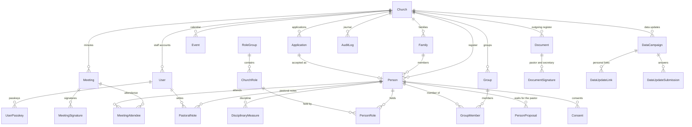
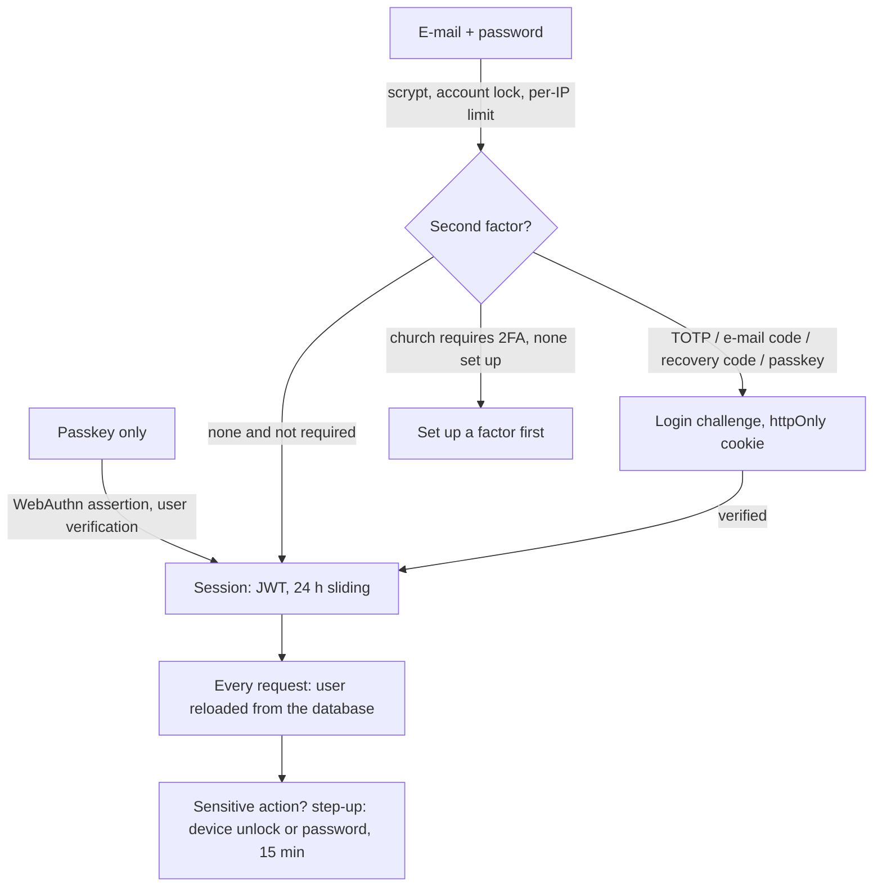

# Architecture

A technical overview for reviewers: how the app is built, how one church's data is kept apart from another's, how people sign in and what they may do, and what is protected how. The threat model and the incident steps are in [SECURITY.md](SECURITY.md); setup and deployment in the [README](../README.md); decisions and priorities in [ROADMAP.md](ROADMAP.md).

## Stack

| Layer | Choice (version) |
| --- | --- |
| Runtime | Node.js ≥ 22.12 |
| Web framework | Next.js 16.4 (App Router, React Server Components, server actions, Turbopack), React 19.2 |
| Database | PostgreSQL (Render managed), Prisma 7.10 with the `@prisma/adapter-pg` driver adapter |
| Authentication | Auth.js 5 (`next-auth@5.0.0-beta.32`, Credentials provider, JWT sessions); TOTP and passkeys implemented in the app (`node:crypto`, `@simplewebauthn/server` 14 / `@simplewebauthn/browser` 14) |
| Validation | Zod 4 (Romanian messages) |
| UI | Tailwind CSS 4, server-rendered SVG charts, Tiptap 3 rich-text editor (stored as validated JSON) |
| Documents | pdfkit (embedded Source Serif 4), `docx` (Word), `exceljs`, `mammoth` (.docx import), `sharp` (signature images) |
| E-mail | Resend (optional) |
| Scan reading | Anthropic Claude API (optional, off per church until an administrator enables it) |
| Tests | Vitest 5: `unit` and `integration` projects (466 tests at the time of writing) |

Everything a user sees is Romanian; code, comments and developer documents are English.

## Code layout

```
src/proxy.ts            per-request CSP nonce and "has a session?" redirect (not an authorization layer)
src/app/(auth)/         public pages: sign-in, 2FA, signup, invitation, password reset, application form, data update
src/app/(app)/          the modules (each page calls requireCtx)
src/app/pdf/**, api/**  route handlers: PDF / Word / Excel, exports, health check
src/server/             server-only code: database, tenant scope, session, audit, crypto, e-mail, queries/, actions/
src/domain/             pure business logic (statistics, report, document texts, print specs, backup validation)
src/lib/                pure shared code (dates, labels, permissions, zod schemas, helpers)
prisma/                 schema, 47 migrations, demo seed
tests/                  integration (tenant isolation, numbering, anonymisation, …) and prototype parity tests
```

`src/domain` and `src/lib` never touch the database, so most rules are unit-tested without one.

## Data model

Every church-owned table has a `churchId` column (34 models in total). The main relations:



Dates of the domain (birth, baptism, meetings) are `DATE` columns handled as `YYYY-MM-DD` strings; "today" is computed in the church's time zone, never from the server clock's date.

## Tenant isolation

- **One scoped client per request.** Pages, route handlers and actions receive `ctx = { user, db }`; `ctx.db` is the Prisma client extended by `scopeToChurch` (`src/server/tenant-scope.ts`). For every model in `TENANT_MODELS` it adds `churchId = ctx.user.churchId` to the `where` of reads, updates, deletes and counts, and to the `data` of creates.
- **The church id has one source:** the signed-in user, reloaded from the database. It is never read from a form, a URL or a request body. Public pages (application form, data update) take the church from the slug or from the link row found by a token hash, then use the same scoped client.
- **What the extension does not cover, and how it is handled:** nested writes (`connect`/`create` inside a relation) and raw SQL. Every referenced id is verified explicitly (`assertPersonsInChurch`, the meeting and role checks in the actions), and raw SQL writes the `churchId` condition by hand. Child tables without `churchId` (attendees, signatures, group members, person roles) are reached only through their parent, which was found with the scoped client.
- **Tests:** `tests/integration/tenant-isolation.test.ts` runs against a real PostgreSQL database and checks, for each tenant model, that another church's client cannot find, count, update or delete the rows (P2025 on direct updates). Adding a church-owned model requires an entry in `TENANT_MODELS` and a case in that test. `tests/integration/anonymize.test.ts` scans every table for leftovers after a person is anonymised.

## Authentication



- **Passwords:** scrypt with a per-user salt; at least 10 characters, not among the 10 000 most common, without the e-mail or the name. Unknown address, wrong password and locked account give the same answer and cost the same scrypt work (no account enumeration).
- **Second factors:** TOTP (RFC 6238, secret encrypted at rest, each code accepted once), a 6-digit e-mail code (hashed, 10 minutes, single use), 8 single-use recovery codes (hashed), and passkeys. An administrator can require a second factor for the whole church.
- **Passkeys (WebAuthn):** relying party from `APP_URL`; user verification required; challenges are random, hashed, single use, valid 2 minutes and bound to a purpose (sign-in, second factor, confirmation, a specific document's signature) and to the user; the signature counter must increase. A passkey alone signs in, unless the church policy "parolă + Face ID / amprentă" asks staff for both.
- **Step-up:** exports, discipline, pastoral notes, user and security settings need a fresh confirmation (device unlock, or the password for users without a passkey), kept 15 minutes in an HMAC-signed httpOnly cookie bound to the user's `sessionVersion`.
- **Sessions:** Auth.js JWT in an httpOnly, `SameSite=Lax`, `Secure` cookie, 24 hours, renewed at most once an hour while in use. `getCurrentUser()` reloads the user on every request (active flag, role, pastor flag, `sessionVersion`), so deactivation, a role change or "Deconectează-te de pe toate dispozitivele" take effect immediately.

## Authorization

- **Roles:** Administrator, Secretar, Vizualizare. Permissions are functions in `src/lib/permissions.ts` (`write`, `admin`, `export`, `audit`, `disciplina`, `pastor`, `pastoral`).
- **The pastor flag** (`User.isPastor`, Statut art. 38–39) is independent of the role: a pastor may be a viewer. It grants the pastor's approvals (documents, applications, reabilitări and excluderi), discipline (together with administrators) and the pastoral notes (pastors only, never administrators by role).
- **Enforcement on the server, everywhere:** pages and route handlers call `requireCtx(permission)` (redirect to sign-in, or `forbidden()`), server actions call `actionCtx(permission)` (a Romanian error message). Hiding a button is cosmetic only. Writes that matter are audited in the same transaction (`writeAudit`), storing only changed fields and names instead of ids.

## Rate limiting

In memory, per instance (`src/server/ip-limits.ts`, `src/server/rate-limit.ts`): sign-in 10 / 15 min per IP, signup 5 / h, forgot password 5 / h per IP and 3 / 15 min per address, 2FA codes 10 / 15 min, passkey attempts 10 / 15 min, application form 5 / h per IP and church, campaign identity checks 20 / h per IP, minutes e-mails 20 / h per church, scan reading 60 / day per church. The client IP is trusted only behind the configured proxy (`AUTH_TRUST_HOST=true`; the last `X-Forwarded-For` entry or `cf-connecting-ip`).

## Browser security headers

- Content-Security-Policy with a per-request nonce set in `src/proxy.ts` (`script-src 'self' 'nonce-…' 'strict-dynamic'`, no `unsafe-inline` for scripts, `object-src 'none'`, `base-uri 'self'`, `form-action 'self'`, `frame-ancestors 'none'`, `upgrade-insecure-requests` on HTTPS). Every page therefore renders dynamically.
- `Strict-Transport-Security` (1 year, subdomains), `X-Content-Type-Options: nosniff`, `Referrer-Policy: strict-origin-when-cross-origin`, a restrictive `Permissions-Policy`, `X-Frame-Options: DENY` (`SAMEORIGIN` only for `/pdf/**`, which the app previews in a frame). Server actions check the `Origin` header (Next.js).

## Encryption and hashing at rest

| Data | Protection |
| --- | --- |
| Passwords, recovery codes | scrypt |
| Invitation, reset and campaign link tokens, e-mail codes, login and WebAuthn challenges | sha256 of a random token; the token only reaches the user |
| TOTP secrets, pastoral notes | AES-256-GCM, keys derived from `AUTH_SECRET` with HKDF per purpose (`src/server/secret-box.ts`); `npm run secrets:reencrypt` re-encrypts them before an `AUTH_SECRET` rotation |
| Passkeys | public keys only (the private key never leaves the device) |
| Everything else | PostgreSQL on Render (disk encrypted at rest by the provider); no files are written to the server's file system |

## Logging

The application log keeps errors with their kind and timing, never tokens, links, codes, recipients, signatures, document contents or pastoral notes; tests assert that no token reaches the logs. The audit log (Setări → Jurnal) records who changed what and when, with names instead of ids; disciplinary entries are visible only with `disciplina`, pastoral-note entries (which never contain the text) only to pastors. Only truncated IP addresses are stored.

## Backups

The church's administrator downloads a JSON export (password and step-up again, audited); the app reminds when the last one is older than 30 days. Render provides point-in-time recovery and on-demand logical backups. Pastoral notes, passkeys, document signatures and the proposals waiting for the pastor are deliberately not in the JSON export. The policy and the restore test are in [SECURITY.md](SECURITY.md#backup-policy).

## Deployment

- Render Blueprint (`render.yaml`): one web service and one PostgreSQL database, both in the **Frankfurt (EU)** region, connected over Render's private network; the health check is `/api/health`. The service deploys every push to `dev`; migrations run with `prisma migrate deploy` as the first step of the start command.
- Configuration through environment variables only (`DATABASE_URL`, `AUTH_SECRET`, `APP_URL`, `AUTH_URL`, optional `RESEND_API_KEY`, `ANTHROPIC_API_KEY`); `APP_URL` must be the real public address (links in e-mails, the passkey relying party).

## CI gates

GitHub Actions on `dev`, `main` and pull requests: `npm ci`, `npm run audit:check` (fails on high or critical advisories not in an expiring allow-list), then `npm run check` = ESLint, `next typegen` + TypeScript, all Vitest tests (unit and integration against a PostgreSQL service) and the production build. Pull requests also run GitHub's dependency review.

## Known limitations

- Rate limits and lockout counters live in memory: they reset on a deploy and would not be shared between several instances (the service runs one).
- There are no end-to-end tests in the repository; flows are checked by scripted browser smoke tests before each release.
- Whoever holds both the database and `AUTH_SECRET` (the hosting account) can decrypt TOTP secrets and pastoral notes; encryption protects against a leaked dump or backup, not against the operator.
- The pastoral notes are not in any backup, by design: a lost database loses them.
- The Word version of an unapproved document carries the "CIORNĂ — neaprobat" mark in the page header, not as a diagonal watermark.
- Reading scans sends the file to the Anthropic API (outside the EEA); it is off until an administrator enables it after reading the processing terms.

## Roadmap

See [ROADMAP.md](ROADMAP.md).
